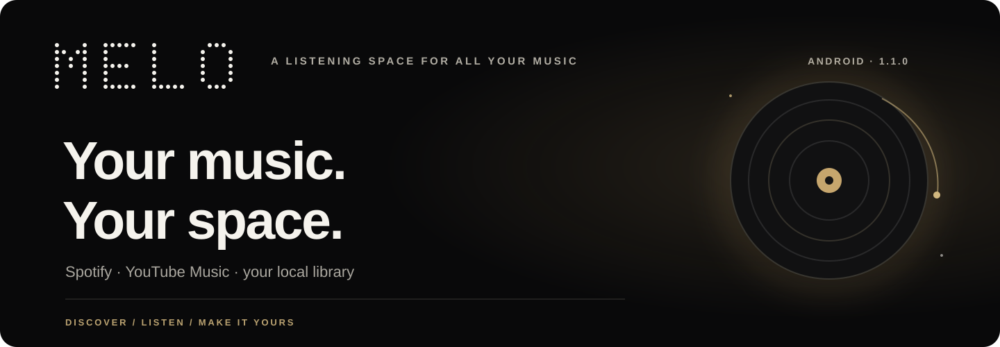
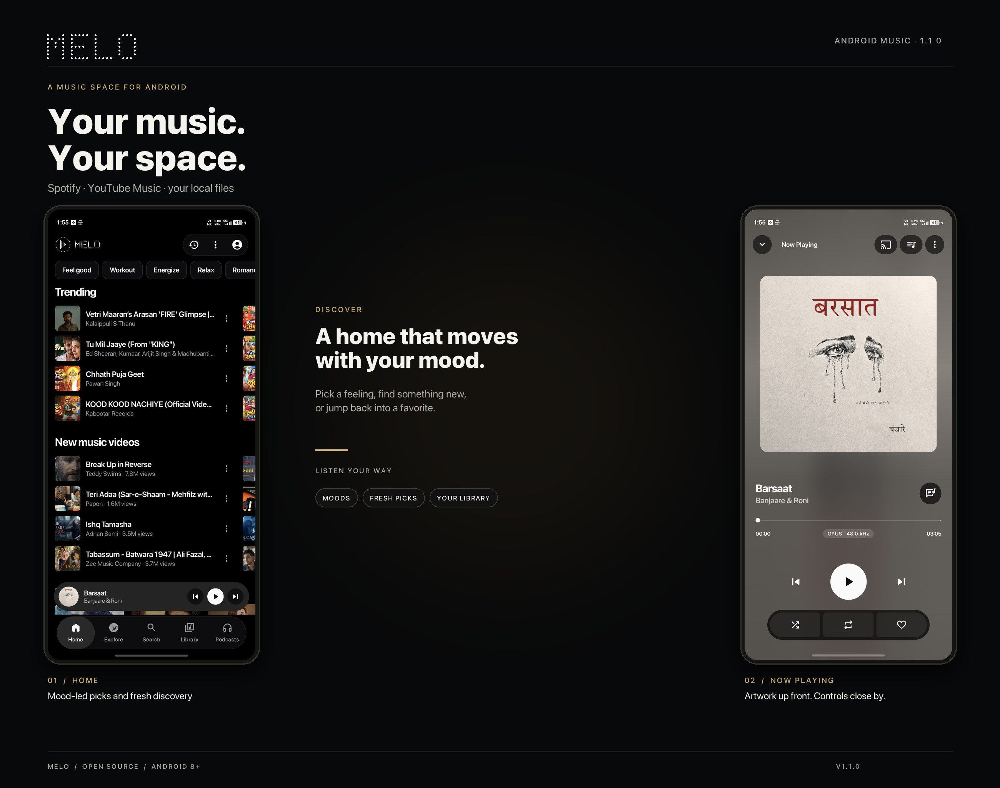
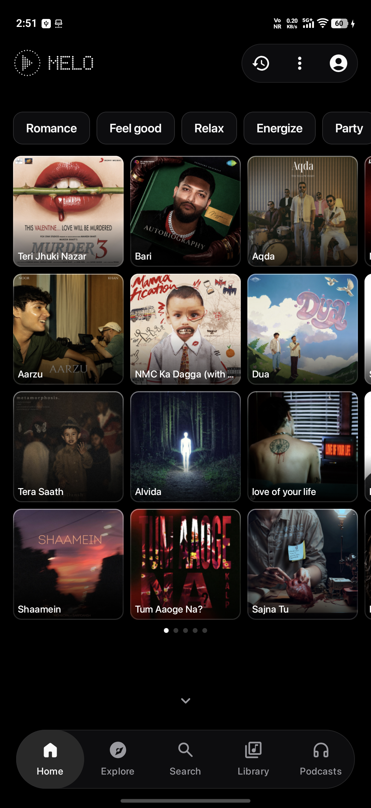
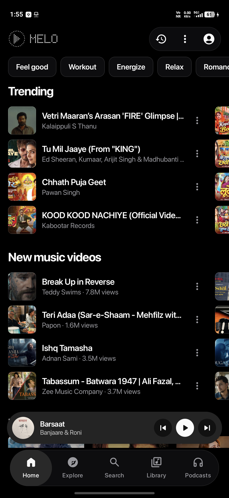
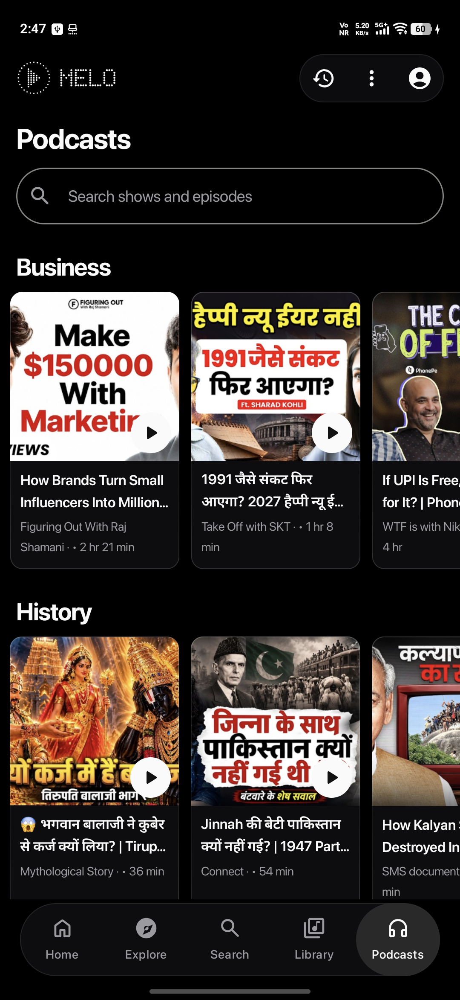
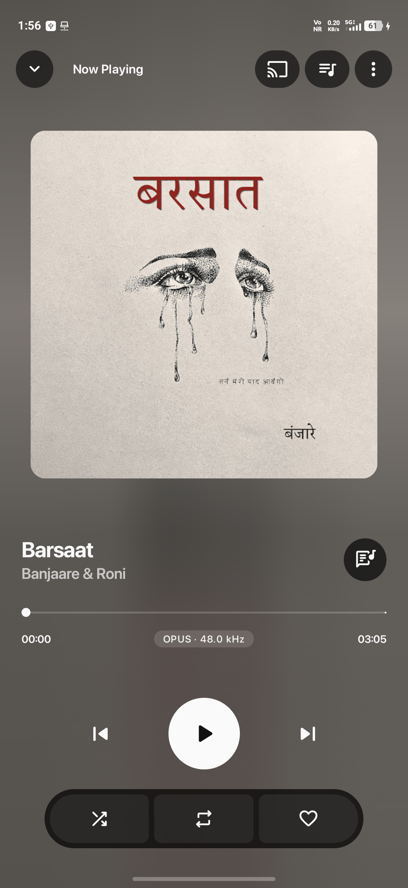
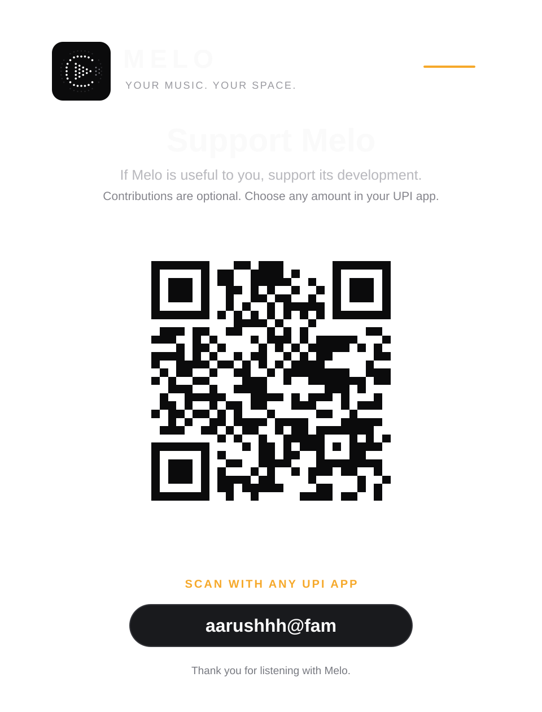

  

  <strong>Your music. Your space.</strong> 
  Spotify, YouTube Music, and your local library in one Android player.

  
  
  
  

  <a href="#download">Download</a> ·
  <a href="#features">Features</a> ·
  <a href="#screenshots">Screenshots</a> ·
  <a href="#support">Support</a> ·
  <a href="#contribute">Contribute</a> ·
  <a href="https://discord.gg/h3Hzk4seXj">Discord</a> ·
  <a href="PRIVACY.md">Privacy</a>

---

Melo is a native Android music player for Spotify, YouTube Music, and music stored on your device. Find something to play, keep your library together, and make the listening experience your own.

> **Independent project:** Melo is not affiliated with or endorsed by Spotify, YouTube, Google, or their parent companies. The app ID is `in.melo`.

## Features

- **Your music together.** Browse Spotify, YouTube Music, and local audio in one app.
- **Find something for the moment.** Explore recommendations, Speed Dials, mixes, and podcasts.
- **A full music player.** Keep the queue, lyrics, downloads, listening history, and playback controls close at hand.
- **Make it yours.** Personalize the appearance, playback, navigation, and equalizer settings.
- **Artwork in full colour.** Album covers and artist photography bring warmth to a restrained interface.

Service access and playback features depend on the source, account, region, and current service behavior. See the [FAQ](docs/FAQ.md) for account, device, and playback details.

## Screenshots

  

  
View individual screens

  

    
    
  

  

    
    
  

## Download

  

<strong>Android 8.0 or later · ARM64</strong>

Download the latest signed APK from [GitHub Releases](https://github.com/aarush-io/melo/releases/latest), open it on your device, and approve installation. If Android asks, allow the app you used to download Melo to install unknown apps. Melo installs separately from other music apps and keeps its own settings, sign-in, and downloads.

Melo can check for updates and guide you through installing a newer release. See [how updates work](docs/FAQ.md#how-do-application-updates-work).

## Support

Melo is free to use. If it has earned a place in your rotation, you can support its development with a voluntary UPI contribution. Scan with any UPI app and choose an amount.

  

UPI ID: `aarushhh@fam`

## Contribute

Bug reports, device testing, documentation, and code contributions are welcome. Start with the [contribution guide](CONTRIBUTING.md), and see the [build-from-source guide](docs/BUILDING.md) if you want to compile Melo yourself.

  

For bug reports, include your Melo version, Android version, device model, and steps to reproduce. For security issues, use [SECURITY.md](SECURITY.md).

## Legal

Melo is distributed under the [GNU General Public License v3](LICENSE). The app is independent of Spotify, YouTube, and Google. Third-party names and marks belong to their respective owners. The Spotify runtime is third-party software and remains subject to its own terms. The YouTube Music integration credits [Resona](https://github.com/code-saksham-hash/Resona); dot-matrix typography uses [Doto](https://github.com/google/fonts/tree/main/ofl/doto), under the [SIL Open Font License](design/Doto-OFL.txt).

For data and privacy details, see [PRIVACY.md](PRIVACY.md).
